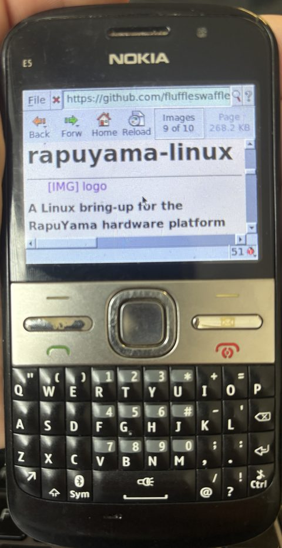
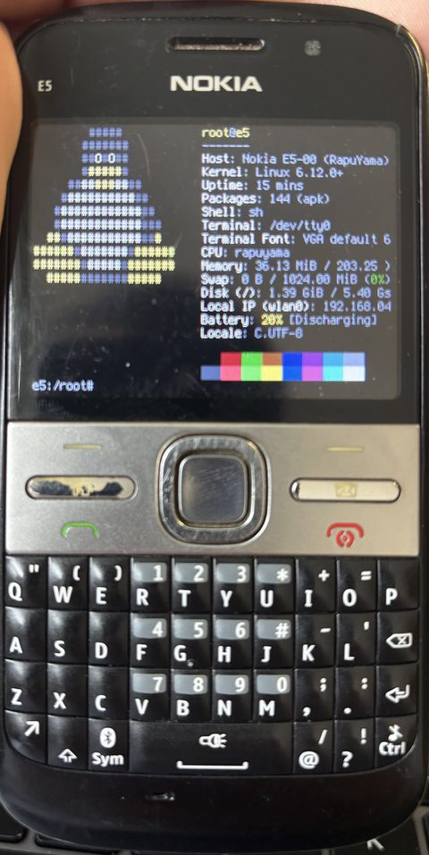
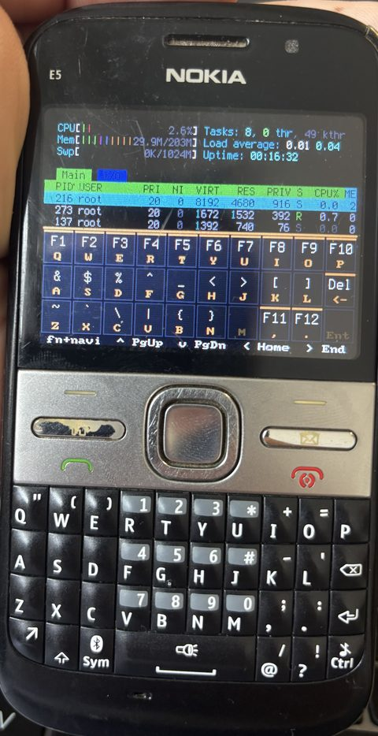

# Linux on the Nokia E5-00

This is the `e5-port` branch of rapuyama-linux: Linux for the Nokia E5-00 (RM-632, firmware 101.003, Symbian 9.3), on the phone's own screen and keyboard. The original E6 project README is [README.md](../README.md).

**Download: [Releases](https://github.com/fluffleswaffles/rapuyama-linux/releases)** (the `-e5` pre-releases; the others are for the E6).

LinuxE5 starts from Symbian like an app and hands the phone over to Linux. Linux runs from RAM. The phone's internal memory is never written, and `reboot` goes back to Symbian.

**Status: alpha.** A console phone: shell on the screen with the hardware keyboard, WLAN, Alpine's `apk`, USB networking, battery level, screen and power management. No calls, no charging under Linux, no sound (see [What doesn't work](#what-doesnt-work)).

<table>
<tr>
<td></td>
<td></td>
<td></td>
</tr>
<tr>
<td>Dillo in X (<a href="#graphical-browser">graphical browser</a>)</td>
<td>fastfetch: Alpine on the memory card, WLAN</td>
<td>htop, with the fn layer picture (<a href="#keyboard">keyboard</a>)</td>
</tr>
</table>

The photos show the [advanced setup](#advanced-alpine-on-the-memory-card) (Alpine on the card). Simple mode looks the same, without the browser.

## You need

- A **Nokia E5-00 with firmware 101.003** (check with `*#0000#`).
- A **microSD card**. The E5 has no E: drive without one, and LinuxE5 loads Linux from it. Simple mode doesn't format or change the card.
- A **hacked phone**: RomPatcher+ with the Install Server patch applied (auto-apply on). LinuxE5 is self-signed but needs all capabilities (it loads its own kernel driver and reads the ROM), and an unpatched Symbian 9.3 refuses to install it. The hack tools are third-party software, so use a phone without personal data on it.
- A **charged battery**. Linux doesn't charge it (charge in Symbian).

## Install (simple mode)

Simple mode runs Linux entirely in RAM: every boot starts fresh and nothing is saved.

1. Charge the phone in Symbian.
2. Download `LinuxE5.sis`, `Image` and `e5.dtb` from the latest `-e5` release (check them with `sha256sum -c SHA256SUMS`).
3. Copy the three files to the root of the memory card (E:\), with a card reader or USB mass storage.
4. Install `LinuxE5.sis` (open it from the card in the file manager). When the installer asks where, choose the **phone memory (C:)**, not the memory card.
5. Start **LinuxE5** from the menu. The first start copies the WLAN firmware and the phone's MAC address out of its own ROM into `E:\linux\`. LinuxE5 waits 5 s, then Linux boots.
6. A welcome screen lists the commands, then the shell takes the keyboard.

```sh
wifi 'network name' 'password'   # connect (WPA/WPA2) and set the clock
apk add fastfetch                # install a package (into RAM)
```

The network and the installed packages are gone after a reboot, so run `wifi` again each time.

**Update** to a new release: copy the new `Image` and `e5.dtb` over the old ones. Reinstall `LinuxE5.sis` only if the release notes say it changed.

**Uninstall**: remove LinuxE5 in Symbian, then delete `Image`, `e5.dtb` and the `E:\linux\` folder from the card.

## What works

| | |
| --- | --- |
| Screen | 320x240 console, brightness control, switches off after 60 s without a key press (any key wakes it, the red end key toggles it) |
| Keyboard | All keys, with layers for the printed symbols (sym) and everything else (fn, with an on-screen picture), see [Keyboard](#keyboard). Keyboard light |
| WLAN | WPA/WPA2, DHCP, the clock from NTP. The phone's own MAC address |
| Packages | Alpine's `apk` (armhf). In simple mode the packages go into RAM |
| USB | Serial shell and USB ethernet to a PC |
| Battery | Level (Symbian's battery table, steady under load), voltage, current, temperature. Clean power-off when it runs low |
| Memory | About 207 MB of the phone's 256 MB for Linux, plus 128 MB of compressed swap in RAM (zram) |
| Memory card | Read and write with DMA (advanced setup) |
| Web browser | `links -g` and Dillo in X, advanced setup only, see [Graphical browser](#graphical-browser) |

## What doesn't work

- **Charging** under Linux. With the cable in, the battery reads "Not charging" and keeps draining. Charge in Symbian, then start Linux.
- **Calls, SMS, mobile data** (the cellular modem is planned for a later version), **sound**, **camera**, **Bluetooth**, **suspend**.
- **Saving anything in simple mode.** The advanced setup (Alpine on the card's own partition, changes are kept) has no installer yet; developers can make the card by hand, see [Advanced: Alpine on the memory card](#advanced-alpine-on-the-memory-card).
- **The real clock.** There is no RTC: the time is wrong until `wifi` sets it over NTP, and TLS (so `apk`) fails until then.

## Using it

| Command | What |
| --- | --- |
| `wifi 'name' 'password'` | Connect and save the network. `wifi` = status, `wifi off` / `wifi on`, `wifi forget` |
| `apk add <package>` | Install from Alpine (needs `wifi` first) |
| `brightness`, `brightness 40%`, `brightness up` | Screen brightness |
| `blank 5`, `blank off` | Screen-off delay in minutes |
| `font list`, `font set ter-112n` | Console font (advanced setup) |
| `cat /sys/class/power_supply/battery/capacity` | Battery %. Also `voltage_now`, `current_now` (uA, negative = discharging), `temp`, `status` |
| `echo 0 > /sys/class/backlight/gazoo-pwm0/brightness` | Keyboard light off (127 = full) |
| `dmesg` | Kernel log |
| `reboot`, `poweroff` | Back to Symbian, phone off |

### Keyboard

Two layers on top of the printed letters, the same in the console and in X:

- **sym** (bottom row, third key): the second symbol printed on each key (digits, `" ( ) * + = # - ' ; : / !`). Hold it, or tap it once for the next key. Mail locks it in the console.
- **fn** (bottom left, arrow): everything not printed, for **one** key. Tapping fn shows a picture of this layer on the bottom half of the screen until the next key; fn again closes it.

| Keys | With fn |
| --- | --- |
| Q W E R T Y U I O P | F1 ... F10 |
| A S D F G H J K L, backspace | `& $ % ^ _ < > [ ]`, Delete |
| Z X C V B N | `` ~ ` \ | { } `` |
| `,` `.` | F11, F12 |
| Navi up, down, left, right | Page Up, Page Down, Home, End |

Front keys: left soft key = Esc, Home = Alt (for the next key), call key = Tab, right soft key = Ctrl (for the next key), red end key = screen off/on. In X, Mail toggles pointer mode (see [Graphical browser](#graphical-browser)).

### WLAN

`wifi 'name' 'password'` saves the network in `/etc/wpa_supplicant/wpa_supplicant.conf` and connects: `wpa_supplicant`, DHCP, then NTP. In simple mode `/etc` is in RAM, so the network is forgotten at reboot; on the advanced setup it connects again at every boot.

WLAN needs LinuxE5 to have run once with the memory card in: it copies the firmware and the MAC address (`E:\linux\e5-wlan-mac`) from the phone's ROM, and Linux loads them at boot. No Nokia files are in the release. An address in `/etc/e5-wlan-mac` on the advanced setup takes priority.

### USB network and serial shell

Plug the USB cable in before starting LinuxE5 (so Symbian leaves the USB block powered). The PC sees a serial port (e.g. `picocom /dev/ttyACM0`, then Enter) and a network interface. The phone asks for an address on `usb0` by DHCP; on the PC, make the new `enx02e500000001` interface a NetworkManager shared connection:

```sh
nmcli connection add type ethernet ifname enx02e500000001 con-name e5-usb ipv4.method shared ipv6.method ignore
```

The phone then gets an address in `10.42.0.0/24`, and the PC is `10.42.0.1`.

## Troubleshooting

| Problem | Fix |
| --- | --- |
| The installer refuses `LinuxE5.sis` (certificate or capability error) | The Install Server patch is not active. After a battery pull or reset, open RomPatcher+ and check that it is applied |
| "No memory card (E:)." | Put a card in. Simple mode needs it too |
| "E:\Image missing." / "E:\e5.dtb missing." | Copy the release files to the root of the card (not into a folder) |
| `wifi` says "no wlan0" | Start LinuxE5 once with the card in, it copies the WLAN firmware to `E:\linux\` (`dmesg \| grep wlan` shows why) |
| `apk` fails with a TLS or certificate error | The clock is wrong: connect with `wifi` first (it sets the clock), or `wifi` again |
| The screen is black but the phone is on | The screen is off: press any key |
| The phone resets or freezes | Start `e5logs` in Symbian before taking the battery out (developers, see [Build](#build)), it saves the kernel log to `E:\klog.bin` |

## Advanced: Alpine on the memory card

For developers until it has an installer. Alpine lives on a second partition of the card (btrfs), so changes are kept, and the graphical browser, the console fonts and a 1 GiB swapfile become available. The same `Image` and `e5.dtb` boot it: Linux uses the card's second partition when it finds one, and falls back to simple mode when it doesn't.

`tools/sdroot.sh /dev/sdX e5` **erases the whole card** (back up E: first). It makes p1 FAT32 2 GiB (Symbian's E:, still mounted by Symbian) and p2 btrfs with Alpine (apk, nano, tmux, htop, python3, git, ssh) plus the E5 files. It needs a finished `linux/kernel/build-e5.sh` (for `build-e5/initramfs.list`). Then copy `Image` and `e5.dtb` to p1.

To update a card made before a change, mount p2 on a Linux PC (here at `/mnt/p2`) and copy the E5 files again; `sdroot.sh` copies a few more by hand (`font`, `wifi`, `browser`, the X config and the motd, see the end of the script):

```sh
grep '^file' linux/kernel/build-e5/initramfs.list | while read -r _ dst src mode _; do
	sudo install -D -m "$mode" "$src" "/mnt/p2$dst"; done
```

### Graphical browser

X and the browsers need about 240 MB on the card (mostly Mesa libraries that X depends on but does not load here). With WLAN up:

```sh
apk add xorg-server xf86-video-fbdev xf86-input-evdev xinit font-misc-misc dillo font-dejavu links-graphics
```

`browser` starts X on the framebuffer (about 30 s) with Dillo, `browser links` with `links -g`; a URL can follow. Quitting the browser returns to the console. X uses the keypad directly (`/etc/X11/xorg.conf.d/10-e5.conf`), with OpenGL and video overlays switched off (there is no GPU). In use: about 25 MB of RAM in total.

| Key | In X |
| --- | --- |
| Right soft key | Ctrl for the next key: rsk+L address bar, rsk+Q quit (Dillo) |
| Mail | Pointer mode on/off |
| Navi key | Arrows; in pointer mode it moves the pointer (`E5_PTR_STEP`, default 2 pixels per step, accelerating while held) |
| Enter, navi centre | Enter; in pointer mode a left click |
| sym, fn | As in the console (see [Keyboard](#keyboard)) |

`links -g` works from the keyboard alone. Dillo needs pointer mode to follow links. Alpine's NetSurf framebuffer build and `links` without X can't draw on the E5 screen.

## Build

### Requirements

A Linux PC with:

- the E6 setup from the [main README](../README.md): submodules, `work/dl/busybox-armv5l`, the Symbian toolchain for the loader;
- an ARM cross compiler as `arm-linux-gnu-` (`export ARCH=arm CROSS_COMPILE=arm-linux-gnu-` for a direct `make`);
- `dtc`, `cpio`, `python3`;
- `clang` for `e5-keyd` (built against the Alpine sysroot in `work/sysroot-alpine`, which the build makes);
- network access on the first build: the initramfs gets `wpa_supplicant`, `iw` and `apk` from Alpine (cached in `work/rootfs-e5-simple`).

### Loader (LinuxE5)

The 9.3 kernel lacks two `DObject` virtuals that the ^3 headers declare, so the E5 builds use their own header tree:

```sh
driver/mkstage-e5.sh
```

LinuxE5 has uid `0xe1000064`, its own menu name and icon. The phone only accepts a SHA-1 signing certificate, so pass yours with `CERT=`:

```sh
cd linux/stage0/symbian-loader
STAGE=$PWD/../../../driver/stage-e5 LDD_SRC=e5boot_ldd.cpp NO_BLOBS=1 \
CERT=/path/to/cert_sha1.pem RB_DEFS="-DRB_IMAGE_BOOT -DRB_E5 -DRB_E5_ISAH" \
CAPTION="LinuxE5" ICON=$PWD/../../../driver/sis/linuxe5.svg \
./build_app.sh linuxb boot_app.cpp 0xe1000064
```

RAM log reader (`e5logs`, uid `0xe1000056`, writes `E:\klog.bin`, read it with `tools/parse_klog.py`): same variables, but `RB_DEFS="-DRB_E5"` and `./build_app.sh e5logs ramread_app.cpp 0xe1000056`.

### Kernel, dtb and initramfs

Release Image, without Nokia files (the WLAN firmware comes from `E:\linux\` at boot):

```sh
cd linux/kernel
KOUT=$PWD/build-e5-pub E5_WLAN_FW=/none ./build-e5.sh config
KOUT=$PWD/build-e5-pub ./build-e5.sh build    # -> build-e5-pub/arch/arm/boot/Image, build-e5-pub/e5.dtb
```

Release files: `tools/e5-release.sh out/linuxb.sis` builds this Image (with a neutral `user@host` in the version string), checks that no firmware, saved network, MAC address or path of the build PC is in it, and writes `LinuxE5.sis`, `Image`, `e5.dtb` and `SHA256SUMS` to `out/e5-release/`.

Development Image with the WLAN firmware built in: cut it from a dump of your own E5 ROM (`Sys\Bin\wlanhwinit.dll`, firmware 101.003; file offsets in a dump that starts at ROM address `0x80000000`). It is not in the repo.

```sh
mkdir -p fw/ti-connectivity
dd if=e5rom.dmp of=fw/ti-connectivity/wl1251-fw.bin bs=1 skip=$((0x92eb73)) count=200460
{ dd if=e5rom.dmp bs=1 skip=$((0x92e6fe)) count=729; head -c 3 /dev/zero; } > fw/ti-connectivity/wl1251-nvs.bin
E5_WLAN_FW=$PWD/fw linux/kernel/build-e5.sh   # -> build-e5/arch/arm/boot/Image, build-e5/e5.dtb
```

The firmware is `Rev 4.0.4.12.12` (200460 bytes), the nvs 732 bytes. LinuxE5 cuts the same bytes from the phone's own ROM.

### Boot a development build

Copy `Image` and `e5.dtb` to `E:\`, install `out/linuxb.sis` to C: and start it, as in [Install](#install-simple-mode). After a crash, run `e5logs` before taking the battery out, then read `E:\klog.bin` with `tools/parse_klog.py`. The RAM log at `0x1f000000` survives a warm reset.

## How it works

The E5 has the same RapuYama SoC as the E6. It differs in the timer, display, keyboard, WLAN and secure-watchdog details, so it gets its own loader build, device tree and drivers. The hardware facts and on-device measurements are in [docs/devices/e5-00/hw-map.md](../docs/devices/e5-00/hw-map.md).

| Part | How |
| --- | --- |
| Boot | LinuxE5 (`boot_app.cpp` under `RB_E5`, LDD `e5boot_ldd.cpp`) loads `E:\Image` + `E:\e5.dtb` into RAM and hands off. The RAM log at `0x1f000000` survives a warm reset |
| System tick | IRQ 35, 1 kHz (`timer-rapuyama-e5.c`) |
| CPU idle | `e6.idle=1`: Symbian's shallow WFI between interrupts (`mach-rapuyama/idle.c`) |
| Watchdogs | SoC/PMIC watchdog with the E6 driver; PA_SWD secure watchdog via the bridge's `nokia,e5` entry (`e6.swd=1`) |
| Memory | `e6.lowmem=2` gives back the RAM below the loader block, keeping only what Symbian's leftovers still use: about 207 MB (`e6.lowmem=1`: about 178 MB) |
| Display | 320x240 fbdev + fbcon over RFBI (`rapuyama-e5-fb.c`). DISPC + RFBI DMA push as Symbian does it: a full frame in about 20 ms with the CPU free, instead of 36-57 ms of CPU byte writes. `rapuyama_e5_fb.dma=0` (command line or `/sys/module/rapuyama_e5_fb/parameters/dma`) goes back to the CPU path. Panel DCS backlight (`/sys/class/backlight/panel`), panel sleep on console blank, an overlay for the bottom half (used by `e5-keyd` for the fn picture) |
| Keyboard | Polled 8x8 matrix (`rapuyama-e5-keypad.c`). The layers come from one table (`tools/e5_keys.py`) through `e5-kmap.py` and `e5-xkb.py` (`linux/initramfs/e5.kmap`, `e5.xkb`). `e5-keyd` draws the fn picture with the phone's own console fonts and toggles the screen on the end key |
| End key | `KEY_POWER` from the Gazoo PMIC latch, polled every 150 ms (`rapuyama_wdt.c`, `nokia,power-key`) |
| Keyboard light | Gazoo PMIC PWM 0, `/sys/class/backlight/gazoo-pwm0` (0..127) |
| microSD | MMC controller `0x20032800`, IRQ 173, E6 `cgc` clock gates. DMA through the general DMA controller (`rapuyama-gdma.c`, reversed from `dma.dll`, clock off when idle): on a class 2 card about 8 MB/s read with 0.67 s of CPU per 32 MB (PIO: 1.72 s), 4 MB/s write. Without the GDMA node, PIO with the FIFO interrupt at 8 of 32 words |
| WLAN | TI WL1251 on SPI 2 (`spi-rapuyama.c`), firmware and MAC from `E:\linux\`, power save off |
| Battery | Gazoo ADC with the E5's own calibration (`rapuyama-battery.c`). Capacity from Symbian's table, using the voltage plus the drop under load (current x 140 mOhm). `current_now` (5 s average) from the Gazoo current meter. Power-off when the average stays below 3.3 V (Symbian's limit) |
| USB | `g_cdc`: serial shell plus CDC ECM `usb0` |
| Swap | 128 MB zram; on the advanced setup also the 1 GiB `/swapfile` on the card |

### Files

| Path | What |
| --- | --- |
| `linux/boot/e5.dts` | Device tree, self-contained (does not include `e6.dts`). The bootargs are documented in it |
| `linux/kernel/build-e5.sh` | Kernel + dtb + E5 initramfs list |
| `linux/initramfs/init.sh` | Shared with the E6; the E5 parts are keyed on `nokia,e5` in the dtb |
| `linux/initramfs/e5-*.sh`, `e5.kmap`, `e5.xkb`, `e5-welcome`, `e5-motd`, `e5-xorg.conf` | The `brightness`, `font`, `blank`, `wifi` and `browser` commands, DHCP, keymaps, welcome texts, X config |
| `linux/initramfs/e5-keyd/` | `e5-keyd` (static C, host tests in `test_core.c`, `build.sh`) |
| `linux/stage0/symbian-loader/boot_app.cpp`, `e5boot_ldd.cpp` | LinuxE5 and its LDD (`AllocBoot`, `LoadChunk`, `Boot`, `ReadPhys`, `SaveIsah`) |
| `linux/stage0/symbian-loader/e5*_app.cpp`, `e5*_ldd.cpp` | Read-only probes used for the bring-up (ids, RAM map, ROM, timers, WLAN) |
| `driver/mkstage-e5.sh`, `driver/sis/linuxe5.svg` | 9.3 header tree, LinuxE5 icon |
| `tools/sdroot.sh`, `tools/e5-release.sh` | Card with Alpine, release files |
| `tools/e5_keys.py`, `e5-kmap.py`, `e5-xkb.py`, `test_e5_keymaps.py` | Keyboard table, keymap generators, tests |
| `tools/parse_isah.py`, `parse_klog.py`, `dram_dump_isasw.py` | Handoff block decoder, RAM log reader, ISASW dump helper |

Kernel (`linux/kernel/linux`, branch `e5`):

| File | What |
| --- | --- |
| `drivers/clocksource/timer-rapuyama-e5.c` | System tick |
| `drivers/video/fbdev/rapuyama-e5-fb.c` | Framebuffer, brightness, panel sleep, overlay |
| `drivers/input/keyboard/rapuyama-e5-keypad.c` | Keyboard matrix |
| `drivers/video/backlight/rapuyama-e5-bl.c` | Keyboard light |
| `drivers/dma/rapuyama-gdma.c` | General DMA controller |
| `drivers/mmc/host/omap.c` | PIO FIFO level from the DT (`nokia,pio-fifo-words`), DMA one word per request |
| `drivers/clk/clk-rapuyama.c` | Resource `0x3a`: the two GDMA clock bits |
| `drivers/spi/spi-rapuyama.c` | SPI 2 for the WL1251 |
| `drivers/power/supply/rapuyama-battery.c` | E5 battery entry |
| `drivers/watchdog/rapuyama_wdt.c` | `rapuyama_pmic_update()` for the light and battery, the end key |
| `arch/arm/mach-rapuyama/secure_wdt.c`, `idle.c` | PA_SWD bridge E5 entry, shallow WFI idle |
| `drivers/gpio/gpio-rapuyama.c`, `drivers/net/wireless/ti/wl1251/spi.c` | GPIO IRQ polarity fix, WL1251 IRQ edge from the DT |
